# F6 — Meeting-start alert animation

Detailed scope for the roadmap feature "Meeting-start alert animation."
Resolves: on meeting start, play a brief alert on the display, then fall back to the
regular display. Hard requirement (captured in `roadmap.md` F6): `MeetingCountdown`,
`MeetingTimeLeft`, and the new alert renderer must each be **resizable to full (24),
half (12), and 1/3 (8) LEDs**.

Recorded 2026-11-15. Depends on the shared seams already shipped (display abstraction,
clock injection, UTC-native time). Build order: width capability → detection → alert
render → on-device verify → (follow-on) side-by-side layout.

## Current state (grounded)

- Ticker (`main.py:142`) runs every **5 s**: renders `half_day`, `meeting_countdown`,
  `meeting_time_left` in sequence, then `display.commit()`. Because each renderer writes
  a full 24-LED frame, this is **last-writer-wins** — `MeetingTimeLeft` owns the display
  today (when a meeting is active); otherwise the half-day frame is last.
- `EventsRepository` (UTC-native, `tz=None` identity):
  - `get_current_event(now)` → first event with `start < now < end`, else `None`.
  - `get_next_event(now)` → first event with `start > now`, else `None`.
  - `get_events_starting_between(start, end)` → `start >= s AND start < e` (half-open),
    **always logs** "Found N events between …". This is the only method that answers
    "what started in an interval" and it tiles time exactly with `[prev, now)` windows.
- `frame_math.progress_frame(led_count, pct, color, palette, justified)` **already accepts
  any `led_count`** → sub-width progress frames are free.
- `Bicolor24Adapter.set_frame(frame)` **rejects** any frame whose length ≠ `LED_COUNT`
  (24) with `ValueError`. It diff-writes the whole 24-LED buffer. So a sub-width frame
  cannot be pushed straight at the adapter — it must be composed into a full 24-frame first.
- `posix_tz.add_seconds(struct, secs)` carries a struct_time forward through
  days/hours — usable for the alert expiry deadline.
- Frozen-by-test-suite seams (do not change existing behavior at existing call sites):
  the three renderer-facing `Display` methods `set_frame` / `set_frame_from_text` /
  `progress` (plus `commit`), and the golden 24-LED renderer frames.

## Goal

When a meeting begins, the display plays an alert for ~5 s (visible blink/sweep), then
returns to the regular display. All three meeting renderers gain a `width` so a future
layout can share the display into columns. Desktop-testable, `tz=None`/default-width
identity keeps existing golden tests green.

## Two sub-problems

1. **Detection** — know *that* a meeting started *this tick* (and which one).
2. **Composition** — show the alert (and, later, alert + regular side-by-side) on one
   24-LED display.

---

## Detection design

**Source of truth:** events that *started* in the interval since the last tick.

Track `_last_now` (a local struct_time, or `None` before the first tick). Each tick:

```
now = utc_to_local(time.localtime(), cal_events.tz)
started = cal_events.get_events_starting_between(_last_now, now, log=False) if _last_now else []
_last_now = now
```

- `[prev, now)` windows tile the timeline: a start exactly at `prev` is excluded from the
  prior tick's `(..., prev)` window and caught by the current `[prev, now)` — **no
  double-count, no missed start**.
- **First tick:** `_last_now is None` → no alert (don't alert on a meeting already in
  progress at boot). Just bootstrap `_last_now`.
- **Concurrent starts (F4 interaction):** `started` is a *list*; fire **one** alert for
  the set, not per-event.
- **Log spam:** the ticker's detection call must pass `log=False`. Add a `log=True` kwarg
  to `get_events_starting_between` (default preserves the gcal fetch-window log at
  `events.py:46`).

**Detection lag:** `now` is sampled every 5 s, so a meeting that starts is detected on
the *next* tick (≤ 5 s late). The alert window is measured **from detection**, not from
the actual start. Acceptable — the alert is a "you have a meeting now" signal, not a
precise-start marker. Note this in the on-device expectation.

### `MeetingAlert` controller (pure, desktop-testable)

A small object owns detection + alert lifetime so it is injectable and unit-testable:

```
class MeetingAlert:
    def __init__(self, duration_s=5, cadence_s=1):
        self._last_now = None
        self._active_until = None     # struct_time deadline, or None
        self._alert_events = None     # the started-this-tick list (for logging/scene)

    def on_tick(self, events_repo, now):
        """Call every tick. Returns the list of events that started this tick."""
        started = []
        if self._last_now is not None:
            started = events_repo.get_events_starting_between(
                self._last_now, now, log=False)
        self._last_now = now
        if started:
            self._active_until = add_seconds(now, self.duration_s)
            self._alert_events = started
        return started

    def is_active(self, now):
        return self._active_until is not None and now < self._active_until

    def reset(self):   # optional: clear state (e.g. after a manual reset)
        self._last_now = None
        self._active_until = None
        self._alert_events = None
```

- `now` is injected → deterministic tests (no wall clock, mirrors the `freeze_clock`
  pattern in `tests/fakes.py`).
- `add_seconds` from `posix_tz` (already in root, stdlib-only).

---

## Composition / width design

**The resizable contract.** Each of the three meeting renderers gains a `width` (default
24) and a **pure** `frame(now)` that returns a `width`-LED frame *without* writing to the
display. `render(now)` stays for the full-width path so existing golden tests (which call
`render(now)` and inspect the recorded frame) keep passing:

| width | LEDs | use |
|-------|------|-----|
| 24    | full    | current default; `render(now)` unchanged |
| 12    | half    | side-by-side column |
| 8     | 1/3     | side-by-side column (smallest of 3 equal columns) |

LED-fill math is already width-correct (`progress_frame` → `floor(width * pct)`):

| pct (time_left example) | width=24 | width=12 | width=8 |
|-------------------------|----------|----------|---------|
| 1.0 (0% elapsed)        | 24       | 12       | 8       |
| 0.5                     | 12       | 6        | 4       |
| 0.25                    | 6        | 3        | 2       |
| 0.0 (100% elapsed)      | 0        | 0        | 0       |

Changes (all **additive** — existing call sites unchanged):
- `BaseRenderer.__init__(self, events, bargraph, width=24)`.
- `meeting_countdown.frame(now)` / `meeting_time_left.frame(now)`: emit a `width`-LED
  frame via `frame_math.progress_frame(self.width, pct, ...)`. `render(now)` writes it
  (full-width path identical to today when `width=24`).
- `Display.progress(pct, color, justified, width=None)` → defaults to `LED_COUNT`;
  delegates to `progress_frame(width or LED_COUNT, ...)`. Existing `progress` calls
  (no width) behave exactly as before.

### Side-by-side composition (the payoff of resizability)

`set_frame` rejects sub-width, so a column layout must build one full 24-frame. Add a
**pure** composer to `frame_math`:

```
def compose(regions):
    """regions = list of (offset, frame). Concatenate into a full-width frame.
    Raises ValueError if the regions don't exactly tile LED_COUNT."""
```

- `compose([(0, [8-LED frame]), (8, [16-LED frame])])` → 24-LED frame.
- The **layout** (who gets which column) composes and calls `display.set_frame(combined)`
  + `display.commit()`. Renderers never push sub-width frames at the adapter directly.

### F6 v1 layout policy (conservative choice)

**v1 = full-width alert.** While the alert is active the display shows the alert
renderer at full width (24). After expiry it falls back to the regular full-width
display (`MeetingTimeLeft`). This meets the requirement ("alert for 5 s then fallback")
and needs **no** side-by-side composition in v1 — the resizable capability (width +
`frame()` + `compose`) is delivered and unit-tested, and side-by-side is enabled by the
same seam for the next layout.

> **Decision to confirm:** is v1 the full-width alert (recommended, minimal refactor,
> golden tests stay green), or do you want the alert laid out **side-by-side** with a
> regular renderer in v1 (e.g. alert = 1/3 column + `MeetingTimeLeft` = 2/3)? The
> capability is in place either way; only the v1 layout + a small `compose`/layout step
> differ. Side-by-side is the natural end-state.

### Alert state flow

```mermaid
stateDiagram-v2
    [*] --> Idle: boot, _last_now=None
    Idle: no current alert
    Idle --> Detecting: each tick (5s)
    Detecting: get_events_starting_between(prev, now)
    Detecting --> Idle: no start this tick
    Detecting --> Alerting: ≥1 start; active_until = now + 5s
    Alerting: render alert frame (faster cadence)
    Alerting --> Idle: now >= active_until
```



---

## Alert renderer

`renderers/meeting_alert.py` (new). Resizable, width-aware.

- `frame(now)` → a width-LED animation frame. Recommended pattern: a **sweep/blink** —
  fill the width from one end, or pulse a stripe, advancing per cadence step. Pure
  (no hardware), returns a `width`-LED frame.
- **Cadence:** the 5 s ticker can only produce 1 frame over a 5 s alert → not a visible
  animation. Run the alert on a **separate faster cadence** (default 1 s) for the
  alert's duration → 5 frames over 5 s = a visible sweep/blink. A dedicated
  `alert_runner` coroutine (like `refresh_token_runner`/`event_fetcher`) renders the
  alert while `MeetingAlert.is_active(now)`; the main ticker **skips** the meeting
  renderers while the alert is active (or the alert simply overrides), then resumes.
- Duration + cadence configurable: `secrets["alert_duration_s"]` (default 5),
  `secrets["alert_cadence_s"]` (default 1). `secrets.py.dist` gets both keys.

---

## Files (planned, not yet changed)

| File | Change | Notes |
|------|--------|-------|
| `events.py` | `get_events_starting_between(..., log=True)` | add `log` kwarg; ticker passes `False`. Default keeps the gcal fetch-window log. |
| `renderers/base_renderer.py` | `width=24` ctor kwarg; pure `frame(now)` | additive; `render` full-width path unchanged at width=24. |
| `renderers/meeting_countdown.py` | `frame(now)` width-aware | `render` delegates to `frame` at width=24. |
| `renderers/meeting_time_left.py` | `frame(now)` width-aware | same. |
| `renderers/meeting_alert.py` | **new** alert renderer, width-aware `frame(now)` | pure, no hardware imports. |
| `display/frame_math.py` | `compose(regions)` pure helper | for side-by-side (follow-on layout). |
| `display/base.py` | `progress(..., width=None)` | default = `LED_COUNT`; existing calls unchanged. |
| `main.py` | `MeetingAlert` controller + `alert_runner`; wire `width`; skip meeting renderers while alert active | pass `tz`/`now` as today. |
| `secrets.py.dist` | `alert_duration_s`, `alert_cadence_s` | defaults 5, 1. |
| `tests/test_meeting_alert.py` | **new** — alert renderer golden frames per width | stdlib, no board imports. |
| `tests/test_alert_detection.py` | **new** — `MeetingAlert` detection/expiry | inject `now`, fake repo. |
| `tests/test_meeting_countdown.py` | width golden frames (24/12/8) | extend, don't break existing. |
| `tests/test_meeting_time_left.py` | width golden frames (24/12/8) | extend. |
| `tests/test_frame_math.py` | `compose` tiling + mismatch `ValueError` | pure. |

## Test plan (stdlib `unittest`, desktop, no board imports)

- **Detection** (`test_alert_detection.py`):
  - Fake repo with events; drive `MeetingAlert.on_tick(repo, now)` across ticks.
  - First tick → no alert (bootstrap).
  - Tick crossing a start → returns the started event(s); `is_active` true for 5 s, false after.
  - Tiling property: a start exactly at a prior `now` is counted exactly once.
  - Concurrent starts in one interval → single alert (`started` list, not per-event).
- **Width** (`test_meeting_countdown`/`test_meeting_time_left`): for `width in (24,12,8)`,
  `frame(now)` length == width and filled LEDs == `floor(width * pct)` (golden, reuse
  `frame_ascii` from `tests/fakes.py`).
- **Alert renderer** (`test_meeting_alert.py`): `frame(now)` length == width per width;
  animation advances across cadence steps (distinct frames).
- **Compose** (`test_frame_math.py`): `compose` tiles exactly (24 = 8+16, 12+12, 24);
  `ValueError` when offsets don't exactly tile `LED_COUNT`.
- **Regression gate:** `python3 -m unittest discover tests` and
  `TZ=UTC python3 -m unittest discover tests` stay green (existing count + new tests).

## Implementation phases (each independently shippable)

1. **Width capability** — `BaseRenderer.width` + `frame(now)` on the two meeting
   renderers + `Display.progress(width=)` + width golden tests. Default width=24 →
   existing golden tests green. *No on-device behavior change yet.*
2. **Detection** — `MeetingAlert` controller + `get_events_starting_between(log=)` +
   `test_alert_detection`. Pure, desktop-only.
3. **Alert render** — `meeting_alert.py` + `alert_runner` in `main.py` + secret keys;
   wire detection; on-device verify (alert fires on a real meeting start, 5 s, falls back).
4. **Follow-on: side-by-side layout** — `frame_math.compose` (+ optional `Display.set_region`)
   and a layout that puts alert + a regular renderer in columns. Only if the v1 policy
   above is upgraded to side-by-side.

## Risks / open questions

- **Golden tests** pin the full-width `render(now)` output. `frame()` is additive and
  `render` is unchanged at `width=24`, so they should stay green — verify in phase 1.
- **Sub-width `set_frame`** is rejected by the adapter; sub-width frames must go through
  composition, never a direct `set_frame`. v1 avoids this (full-width); the follow-on
  layout is where `compose` earns its keep.
- **Detection lag** ≤ 1 tick (5 s); alert measured from detection, not actual start.
- **Concurrent starts (F4)**: alert once for the set. F4 itself (rendering concurrent
  events) is a separate feature; F6 only handles the *alert* for them.
- **5 s at the 5 s cadence = 1 frame** → the visible animation *requires* the faster
  alert cadence (default 1 s). Without it the alert is a single static 5 s frame.
- **`tz=None` identity:** with no POSIX TZ set, `utc_to_local` is identity and detection
  still works on UTC wall-clock (matches current behavior).
